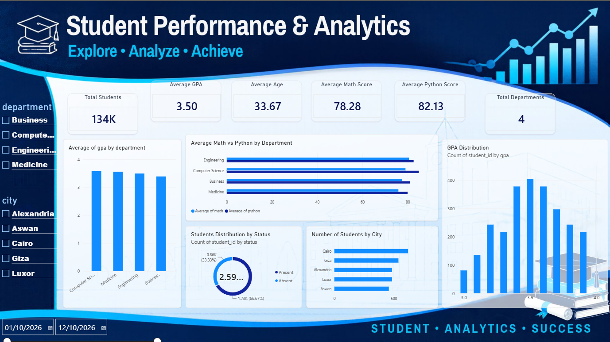

# 🎓 Student Data Engineering & Analytics Pipeline

## 📌 Project Overview

This project implements an end-to-end Data Engineering pipeline that extracts student profiles, academic grades, and attendance records from **MongoDB**, processes and transforms the data using **PySpark**, and stores it in **HDFS** following the **Medallion Architecture (Bronze, Silver, and Gold)** in columnar **Parquet** format.

**Apache Hive** provides external tables for SQL querying over the processed datasets, while **Microsoft Power BI** connects to the analytical layer to deliver an interactive **Student Performance & Analytics Dashboard**—all running inside a containerized **Docker** environment.

---

## 🏗️ System Architecture


---

## 🛠️ Technologies Used

| Technology | Purpose |
| :--- | :--- |
| **MongoDB** | Source database (`school`) storing student info, grades, and attendance collections |
| **Python & PySpark** | Distributed data ingestion, cleaning, transformation, and One Big Table (OBT) modeling |
| **Apache Hadoop (HDFS)** | Distributed storage for the Bronze, Silver, and Gold layers in Parquet format |
| **Apache Hive** | SQL querying engine and External Table management over HDFS |
| **Docker & Docker Compose** | Containerized deployment of the Big Data infrastructure |
| **Power BI Desktop** | Interactive dashboards, KPI tracking, and Data Mining |

---

## 📂 Source Database

**Database:** `school` (MongoDB)

The pipeline ingests three semi-structured collections:
* **`students`:** `student_id`, `name`, `age`, `city`, `department`, `gpa`
* **`grades`:** `student_id`, `math`, `python`
* **`attendances`:** `student_id`, `date`, `status` (`Present` / `Absent`)

---

## 🥉 Bronze Layer — Raw Data

* **Storage:** HDFS (`Parquet` format)
* **Processing:** PySpark

Ingests raw data directly from MongoDB collections without schema alterations, preserving full historical fidelity.

```text
/bronze/school/students/
/bronze/school/grades/
/bronze/school/attendances/
```

---

## 🥈 Silver Layer — Cleaned & Standardized Data

* **Storage:** HDFS (`Parquet` format)
* **Processing:** PySpark

Cleanses and validates records by handling missing values, removing duplicates, standardizing data types, and running data quality checks.

```text
/silver/school/students/
/silver/school/grades/
/silver/school/attendances/
```

---

## 🥇 Gold Layer — Integrated Analytical Model (One Big Table)

* **Storage:** HDFS (`Parquet` format)
* **Processing:** PySpark

Joins the cleaned Silver datasets on `student_id` into a denormalized **One Big Table (OBT)** optimized for analytical workloads and Business Intelligence.

```text
/gold/school/student_analytics/
```

### Gold Table Schema

| Column | Type | Description |
| :--- | :--- | :--- |
| `student_id` | `INT` | Unique student identifier |
| `name` | `STRING` | Student full name |
| `age` | `INT` | Student age |
| `city` | `STRING` | Student city (*Cairo, Giza, Alexandria, Luxor, Aswan*) |
| `department` | `STRING` | Academic department (*Computer Science, Medicine, Engineering, Business*) |
| `gpa` | `DOUBLE` | Cumulative GPA (`3.0` – `4.0`) |
| `math` | `DOUBLE` | Mathematics exam score |
| `python` | `DOUBLE` | Python programming score |
| `date` | `DATE` | Attendance record date |
| `status` | `STRING` | Attendance status (`Present` / `Absent`) |

---

## 🗄️ Apache Hive Integration

Apache Hive provides SQL access to the datasets stored in HDFS through **External Tables**, pointing directly to the corresponding HDFS directories without duplicating storage.

```sql
CREATE EXTERNAL TABLE IF NOT EXISTS student_analytics_gold (
    student_id INT,
    name STRING,
    age INT,
    city STRING,
    department STRING,
    gpa DOUBLE,
    math DOUBLE,
    python DOUBLE,
    attendance_date DATE,
    status STRING
)
STORED AS PARQUET
LOCATION '/gold/school/student_analytics/';
```

**Why External Tables?**
* Hive queries Parquet files directly in HDFS without copying data into Hive-managed storage.
* Data remains decoupled and accessible to Spark and other compatible processing engines.
* Provides a standard SQL interface for downstream BI tools like Power BI.

---

## 📊 Power BI Dashboard & Analytical Insights



### Key Performance Indicators (KPIs)
* **Total Students:** `134K`
* **Average GPA:** `3.50`
* **Average Age:** `33.67`
* **Average Math Score:** `78.28`
* **Average Python Score:** `82.13`
* **Total Departments:** `4`

### Dashboard Breakdown & Visuals
* **Interactive Slicers:** Dynamic filtering by **Department** (*Business, Computer Science, Engineering, Medicine*), **City** (*Alexandria, Aswan, Cairo, Giza, Luxor*), and **Date Range** (`01/10/2026` – `12/10/2026`).
* **Average GPA by Department:** Compares academic standing across all four faculties, led by **Computer Science** and **Medicine**.
* **Average Math vs. Python by Department:** Highlights technical performance across departments, showing consistently stronger averages in **Python (`82.13`)** compared to **Math (`78.28`)**.
* **GPA Distribution:** Histogram illustrating student concentration across GPA brackets (`3.0` to `4.0`), peaking near `3.5`.
* **Students Distribution by Status:** Donut chart tracking attendance distribution (`66.67%` Present vs. `33.33%` Absent).
* **Number of Students by City:** Geographic distribution across major Egyptian cities, led by **Cairo** and **Giza**.

### Analytical Questions Answered
* Which departments achieve the highest average GPA and technical scores?
* How does student performance in Python compare to Mathematics across different majors?
* What is the overall attendance rate (`Present` vs. `Absent`), and how does it correlate with academic standing?
* How is the student body distributed across major cities?

---

## 📂 Repository Structure

```text
├── Images/
│   ├── Untitled Diagram.gif       # End-to-End Big Data Architecture Diagram
│   └── image.png                  # Power BI Interactive Dashboard Screenshot
├── docker/
│   └── docker-compose.yml         # Multi-container setup (MongoDB, Hadoop, Spark, Hive)
├── spark_jobs/
│   ├── 01_bronze_ingestion.py     # MongoDB to HDFS Bronze (Parquet)
│   ├── 02_silver_transform.py     # Data cleaning & transformation to Silver (Parquet)
│   └── 03_gold_modeling.py        # One Big Table (OBT) modeling to Gold (Parquet)
├── hive/
│   └── create_external_table.sql  # Hive DDL script for Gold External Table
├── powerbi/
│   └── Student_Analytics.pbix     # Power BI Dashboard file
└── README.md
```

---

## 🚀 Getting Started

1. **Clone the repository:**
   ```bash
   git clone [https://github.com/yourusername/student-analytics-bigdata-pipeline.git](https://github.com/yourusername/student-analytics-bigdata-pipeline.git)
   cd student-analytics-bigdata-pipeline
   ```
2. **Start the Docker containers (MongoDB, Hadoop, Spark, Hive):**
   ```bash
   docker-compose up -d
   ```
3. **Run the PySpark Medallion ETL pipeline:**
   ```bash
   docker exec -it spark-master spark-submit /jobs/etl_pipeline.py
   ```
4. **Create the Hive External Tables** using the DDL scripts and open the Power BI report (`.pbix`) to explore the interactive dashboard.
